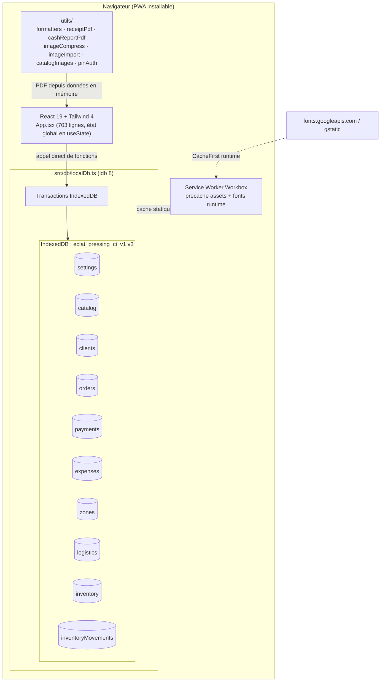
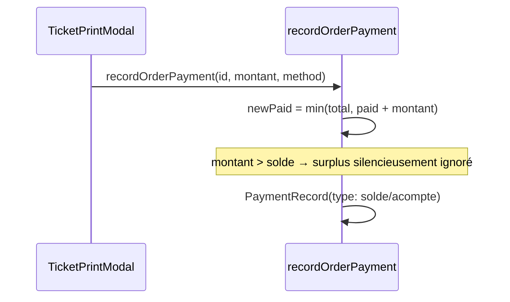

# 01 — Audit d'état actuel et cartographie fonctionnelle

> **Phase 01/10** du playbook de migration backend Go (`GO_BACKEND_MIGRATION_PLAYBOOK.md`).
> Dépôt : `ErwinssKoffi/press_Buand_app` · Branche de référence auditée : `main` (commit `8beb3a0`).
> Date de l'audit : 27 novembre 2026. **Aucune modification fonctionnelle n'a été effectuée.**

---

## 1. Résumé exécutif

**Éclat Pressing** est une application de gestion de pressing et blanchisserie destinée à Abidjan (Côte d'Ivoire), entièrement **offline-first** : 100 % de la logique métier et de la persistance s'exécutent dans le navigateur sur IndexedDB, sans aucun backend applicatif.

| Domaine | Constat |
|---|---|
| Frontend | React 19.3 + TypeScript (v7.0.2 installé) + Vite 8 + Tailwind CSS 4 — application monopage complète et soignée |
| Backend | **Aucun.** Aucun appel réseau métier. `express`, `@google/genai`, `dotenv`, `tsx` sont installés mais **jamais importés** dans `src/` |
| Persistance | IndexedDB `eclat_pressing_ci_v1` (version 3, 10 stores) via `idb@8` — `src/db/localDb.ts` (1 707 lignes) |
| Distribution | PWA installable (`vite-plugin-pwa`, autoUpdate, precache ~8,9 Mo) |
| Monnaie | FCFA/XOF, entiers, formaté `fr-FR` — aucune utilisation de flottants significatifs |
| Paiements | Espèces, Wave, Orange Money, MTN MoMo, Moov Money (5 moyens, unions TS) |
| Auth | PIN 5 chiffres, SHA-256 salé côté navigateur, verrou local uniquement |
| Tests | **Aucun test automatisé**. `lint` = `tsc --noEmit` (passe). Build Vite passe |
| Gestionnaire de paquets | **Bun obligatoire** (`bun.lock`) — `npm install` échoue sur un conflit de peer `esbuild` |

**Verdict :** l'application est fonctionnelle, typée proprement et compile sans erreur, mais son état actuel présente des risques critiques pour un usage réel multi-périphérique : perte d'historique financier sur suppression, import de sauvegarde destructif sans validation, encaissements tronqués silencieusement, et aucune centralisation/sauvegarde des données (IndexedDB est évictable par le navigateur). Ces constats valident la direction du playbook : un backend Go porteur des règles métier, des transactions et de la source de vérité, avec conservation du cache IndexedDB et du mode hors ligne.

---

## 2. Architecture actuelle

### 2.1 Diagramme Mermaid de l'architecture existante



**Caractéristique clé :** il n'y a **aucune couche réseau métier**. `App.tsx` importe directement les fonctions de `src/db/localDb.ts` et les passe aux vues en props (prop drilling). Le mode « hors ligne » est en réalité le mode **unique** de l'application ; le bandeau `OfflineBanner` (via `navigator.onLine`) est purement informatif.

### 2.2 Arborescence pertinente

```text
├── index.html                    # PWA FR, fonts DM Sans / Plus Jakarta / JetBrains Mono
├── vite.config.ts                # PWA + alias "@" + copie src/assets → dist/src/assets
├── metadata.json                 # Provenance AI Studio (capability Gemini, non exploitée)
├── .env.example                  # GEMINI_API_KEY / APP_URL — aucun usage dans le code
├── GO_BACKEND_MIGRATION_PLAYBOOK.md  # Playbook 10 prompts (document de pilotage)
├── public/                       # icônes PWA (192/512/maskable/apple-touch)
├── src/
│   ├── main.tsx                  # bootstrap React
│   ├── App.tsx                   # État global, NAV (9 onglets), orchestre toutes les mutations
│   ├── index.css                 # Tailwind 4 + styles d'impression (no-print / print:*)
│   ├── types/pressing.ts         # 316 lignes — tous les contrats métier
│   ├── db/localDb.ts             # 1 707 lignes — SEULE couche de persistance + règles métier
│   ├── components/               # 16 composants (9 vues + modals + bannières)
│   ├── hooks/                    # useOnlineStatus, usePWAInstall
│   ├── utils/                    # formatters (dont calcul express), pinAuth, PDF, images
│   └── assets/images/            # 9 JPG (hero 784 Ko + 8 visuels catalogue presets)
├── bun.lock                      # lockfile de référence (Bun 1.4)
└── package.json                  # scripts dev/build/preview/lint(tsc)/clean
```

---

## 3. Inventaire exhaustif des modules et parcours

### 3.1 Vues (onglets de navigation, `NAV_ITEMS` dans App.tsx)

| Onglet | Fichier | Lignes | Responsabilités confirmées |
|---|---|---|---|
| Tableau de bord | `DashboardView.tsx` | 785 | KPI du jour (recettes via `payments.paidAt`, dépenses), alertes retard/aujourd'hui/express (`getOrderUrgency`), progression atelier, courbe mensuelle (`MonthlyRevenueChart.tsx` → recharts), actions avancement statut |
| Nouveau dépôt (POS) | `PosDepositView.tsx` | 1 902 | Saisie dépôt : client existant/nouveau, catalogue (pièce/kg), offres au poids, packs blanchisserie, express par ligne, photos de réserves (compression), casier, dates, remise, livraison + zone, prépayé, points fidélité ; construit le brouillon de commande et appelle `onSubmitOrder` |
| Commandes & Suivi | `OrdersView.tsx` | 284 | Liste triée `createdAt` desc, recherche, filtres statut, export PDF A5, suppression, scanner, avancement |
| Enlèvements & Livraisons | `LogisticsView.tsx` | 1 033 | Tâches logistiques (enlèvement/livraison), statuts, zones de livraison (CRUD), conversion enlèvement → dépôt (`onCreateDepositFromPickup`), effet sur commande liée |
| Clients | `ClientsView.tsx` | 639 | CRUD clients, fiche (points, prépayé, abonnement), recharge prépayée avec bonus, historique wallet (plafonné 40), dépôt pour client (`onNewDepositForClient`) |
| Tarifs & Catalogue | `CatalogView.tsx` | 566 | CRUD articles, 8 visuels presets + import image (recadrage 360 px), catégories fixes, unités pièce/kg/paire |
| Stocks & Produits | `InventoryView.tsx` | 1 031 | CRUD articles de stock, mouvements entrée/sortie/ajustement, entrée → dépense automatique optionnelle, alertes seuil |
| Caisse & Dépenses | `CashbookView.tsx` | 646 | Encaissements et dépenses du jour/mois, catégories fixes, rapport Z journalier PDF, bilan mensuel PDF + CSV |
| Paramètres & Sauvegarde | `SettingsView.tsx` | 1 338 | Infos boutique, PIN (changement avec vérification ancien), export backup JSON v3, import backup (destructif), remise à zéro, données démo, réouverture onboarding |

### 3.2 Modals et composants transverses

| Composant | Rôle confirmé |
|---|---|
| `TicketPrintModal.tsx` (1 141) | Ticket imprimable (A5 / thermique 80 mm via `window.print` + CSS print), encaissement du solde (clampé au reste), avancement statut, message WhatsApp (`buildWhatsAppMessage`, copie presse-papiers) |
| `BarcodeScannerModal.tsx` (438) | Recherche ticket exacte puis sous-chaîne (`0048`, `EP-2026-0048`), avancement statut depuis le scanner |
| `LoginView.tsx` (685) | Création/vérification PIN 5 chiffres, lockout 5 tentatives → 15 s (en mémoire), « Code PIN oublié ? » → `onResetPin` **sans vérification** |
| `OnboardingView.tsx` (978) | 4 étapes (Établissement / Activités & Tarifs / Fidélité & Démarrage / Validation), scope pressing/blanchisserie/les deux, option `startFresh` |
| `GarmentThumbnail.tsx` | Miniature article catalogue avec fallback preset |
| `OfflineBanner.tsx` + `useOnlineStatus` | Bandeau `navigator.onLine` (informatif uniquement) |
| `PWAInstallButton.tsx` + `usePWAInstall` | Bouton d'installation PWA (beforeinstallprompt) |

### 3.3 Parcours métier détaillés (tels qu'implémentés)

**P1 — Onboarding** (`OnboardingView` → `App.handleCompleteOnboarding`)
1. Étape 1 : nom, commune, adresse, téléphone/WhatsApp, RCCM.
2. Étape 2 : `activityScope` (pressing / blanchisserie / both) ; si blanchisserie active → services activés, prix unitaires, packs (garmentCount + 3 prix) ; si pressing actif → tarifs au kg par mode, offres au poids, express (fixe/pièce ou %).
3. Étape 3 : fidélité (fcfaPerPoint ≥ 100, seuil récompense ≥ 5, remise ≥ 100) ; option `startFresh` → `clearAllBusinessData()`.
4. Étape 4 : validation → `saveSettings` avec `onboardingCompleted: true`.

**P2 — Verrouillage PIN** (`LoginView` + `utils/pinAuth.ts`)
- Création : `isValidFiveDigitPin` → salt hex 16 octets (`crypto.getRandomValues`, fallback `Math.random`) → `SHA-256("salt:pin:eclat-pressing-pin-v1")` (fallback de mélange **non cryptographique** si `crypto.subtle` indisponible, ex. LAN non-HTTPS) → stockés dans `settings.pinHash/pinSalt`.
- Vérification : comparaison à temps constant ; après 5 échecs → cooldown 15 s (**état React : réinitialisé par un rechargement**).
- Reset : lien « Code PIN oublié ? » sur l'écran de login → `onResetPin()` efface `pinHash/pinSalt` **sans aucune vérification d'identité**.

**P3 — Création de dépôt (commande)** (`PosDepositView` → `App.handleSubmitOrder` → `localDb.createOrderWithPayment`)
1. Construction des lignes : catalogue (unité pièce/kg/paire), offres au poids (`weightKg`), packs blanchisserie (`piecesPerUnit`), express par ligne (`isExpress` + `computeLineExpressFee`) ; total = `max(0, sous-total + express + livraison − remise)` — **calculé uniquement dans le frontend** et transmis tel quel.
2. Prépayé : la vue calcule `actualPrepaidUsed = min(solde client, total, montant demandé)` et transmet `paidFCFA` = cash + prépayé demandé.
3. `createOrderWithPayment` (transaction IndexedDB sur `settings, orders, payments, clients`) : re-sert le prépayé réel, `totalSettledOnOrder = min(total, prépayé + cash)`, points gagnés = `floor(total / fcfaPerPoint)`, points utilisés clampés au solde client, ticket `EP-<année>-<seq 4 chiffres>` depuis `settings.nextTicketSequence` (incrémenté dans la même transaction), PaymentRecord cash si `actualCashPaid > 0` (type `integral`/`acompte`), wallet client mis à jour (entrée `utilisation` si prépayé utilisé).
4. Retour dans `App` : si `pickupContext` (enlèvement converti) → tâche marquée `effectue` et liée ; si livraison auto → nouvelle tâche `livraison planifie` avec note « Solde à encaisser ».

**P4 — Paiement complémentaire** (`TicketPrintModal` → `recordOrderPayment`) : transaction `orders+payments` ; `newPaid = min(total, paid + montant)` — **un paiement supérieur au solde est tronqué silencieusement** (le surplus n'est ni encaissé ni signalé) ; type `solde`/`acompte`.

**P5 — Suivi atelier** : statuts linéaires `recu → lavage → repassage → pret → livre` (`STATUS_META.nextStatus`), `deliveredAt` posé au passage à `livre`. Scanner = recherche ticket exacte puis sous-chaîne.

**P6 — Logistique** : CRUD tâches (enlèvement/livraison) + zones (frais livraison + frais enlèvement) ; `updateLogisticsStatus` : si livraison liée à une commande passe à `effectue` → la commande passe à `livre` **dans une écriture séparée** (non transactionnelle).

**P7 — Prépayé & fidélité** (`topUpClientPrepaid`) : recharge (+bonus) → solde client et `walletHistory` (plafonné **40** entrées, anciennes entrées perdues silencieusement) ; si `cleanAmount > 0` → **PaymentRecord avec `orderId: 'prepaid-<id>'` et ticket `ABON-YYYYMMDD`, type `integral`** → compte comme une recette du jour dans le tableau de bord et la caisse (double lecture comptable : le même FCFA est compté à la recharge puis déduit du ticket via `prepaidUsedFCFA`).

**P8 — Caisse** : dépenses CRUD (5 catégories fixes) ; agrégats jour/mois ; rapport Z PDF journalier ; bilan mensuel PDF + CSV (`bilan-caisse-<YYYY-MM>.csv`).

**P9 — Stocks** : CRUD articles ; `recordInventoryMovement` (transaction `inventory, inventoryMovements, expenses`) : `entree` (+coût, MAJ `unitCostFCFA`), `sortie` **clampée à 0** (stock négatif impossible, aucune alerte), `ajustement` = quantité fixée ; option `recordExpense` → dépense automatique « Achat stock : … » catégorie « Produits & Lessive ». Suppression d'article → **cascade sur ses mouvements**.

**P10 — Sauvegarde** : export `DatabaseBackup` version 3 (tous les stores + `exportedAt`) ; import → `JSON.parse(...) as DatabaseBackup` (aucune validation de structure) puis **`clear()` des 10 stores avant réécriture** dans la même transaction. `clearAllBusinessData` ne vide **que** clients/orders/payments/expenses/logistics/inventoryMovements (garde catalog, zones, inventory) et remet la séquence ticket à 1. `resetDemoData` vide tout et re-seed.

---

## 4. Inventaire des entités et champs (contrat TS `src/types/pressing.ts`)

| Entité | Champs (camelCase, tels que stockés) | Remarques |
|---|---|---|
| `PressingSettings` | `id:'default'`, `shopName`, `tagline`, `commune`, `address`, `phone`, `whatsappPhone`, `rccm`, `expressPercent`, `ticketFooterNote`, `nextTicketSequence`, `activityScope`, `blanchisserieConfig`, `pressingConfig`, `loyaltyConfig?`, `pinHash?`, `pinSalt?`, `onboardingCompleted?` | secrets PIN mélangés aux paramètres métier — à séparer côté Go |
| `BlanchisserieConfig` | `enabledServices` (3 services), `enableUnit`, `unitPricesFCFA` (3), `packs[]` (`id`, `garmentCount`, `active`, `pricesFCFA`) + **champs legacy** `enabledBases?`, `pricesFCFA?` (lots 10/20) | migration legacy gérée dans `normalizeSettings` |
| `PressingConfig` | `weightEnabled`, `pricePerKgByMode` (5 modes), `weightOffers[]`, `expressPricingMode` (`fixed_per_piece`\|`percent`), `expressFixedAmountFCFA`, `expressPercent` | `expressPercent` **dupliqué** au niveau racine de settings (compat) |
| `LoyaltyConfig` | `enabled`, `fcfaPerPoint`, `rewardThresholdPoints`, `rewardDiscountFCFA` | bornes min dans `normalizeSettings` |
| `CatalogItem` | `id`, `name`, `category` (4 catégories), `defaultMode` (5 modes), `priceFCFA`, `unit` (`pièce`\|`kg`\|`paire`), `active`, `imageUrl?`, `turnaroundDays?`, `careNote?` | images = dataURL ou chemin `/src/assets/...` |
| `Client` | `id`, `fullName`, `phone`, `commune`, `addressNote?`, `createdAt`, `loyaltyPoints?`, `prepaidBalanceFCFA?`, `subscriptionLabel?`, `subscriptionExpiresAt?`, `walletHistory?` | dénormalisation : les commandes recopient `clientName`/`clientPhone`/`commune` |
| `ClientWalletEntry` | `id`, `date`, `type` (`recharge`\|`utilisation`\|`bonus`), `amountFCFA` (négatif si utilisation), `method?`, `note?` | plafonné à 40 entrées |
| `PressingOrder` | `id`, `ticketNumber`, `clientId`, `clientName`, `clientPhone`, `commune`, `rackSlot`, `items[]`, `isExpress`, `expressFeeFCFA`, `deliveryFeeFCFA`, `discountFCFA`, `prepaidUsedFCFA?`, `loyaltyPointsEarned?`, `loyaltyPointsRedeemed?`, `claimPhotos?`, `totalFCFA`, `paidFCFA`, `status`, `dropOffDate`, `dueDate`, `deliveredAt?`, `notes?`, `createdAt`, `updatedAt` | montants entiers FCFA |
| `OrderLineItem` | `id`, `catalogItemId`, `name`, `mode`, `quantity`, `unit` (+ `lot`), `unitPriceFCFA`, `note?`, `activityType?`, `pricingBasis?`, `piecesPerUnit?`, `weightKg?`, `isExpress?`, `expressFeeFCFA?`, `expressDueDate?` | ligne express avec échéance propre |
| `IntakePhoto` | `id`, `dataUrl`, `caption`, `itemName?`, `capturedAt` | **photo = dataURL base64 dans la commande** |
| `PaymentRecord` | `id`, `orderId`, `ticketNumber`, `clientName`, `amountFCFA`, `method` (5), `paidAt`, `type` (`acompte`\|`solde`\|`integral`) | recharges prépayées écrites ici avec `orderId: 'prepaid-…'` |
| `ExpenseRecord` | `id`, `label`, `category` (5), `amountFCFA`, `method`, `date`, `note?`, `createdAt` | |
| `DeliveryZone` | `id`, `commune`, `feeFCFA`, `pickupFeeFCFA`, `active` | |
| `LogisticsTask` | `id`, `type` (`enlevement`\|`livraison`), `status` (4), `clientId`, `clientName`, `clientPhone`, `commune`, `addressDetail`, `orderId?`, `ticketNumber?`, `scheduledDate`, `timeSlot`, `courierName`, `courierPhone?`, `estimatedPieces?`, `feeFCFA`, `notes?`, `createdAt`, `updatedAt` | |
| `InventoryItem` | `id`, `name`, `sku?`, `category` (5), `activityScope`, `unit`, `quantity`, `minThreshold`, `unitCostFCFA`, `supplier?`, `notes?`, `updatedAt` | |
| `InventoryMovement` | `id`, `itemId`, `itemName`, `type` (`entree`\|`sortie`\|`ajustement`), `quantityDelta`, `previousQty`, `newQty`, `unit`, `unitCostFCFA?`, `totalCostFCFA?`, `reason`, `createdAt` | |
| `DatabaseBackup` | `version`, `exportedAt` + les 10 collections (`zones?`, `logistics?`, `inventory?`, `inventoryMovements?` optionnels) | version actuelle : **3** |

**Énumérations à préserver telles quelles** : statuts `recu|lavage|repassage|pret|livre` ; moyens `especes|wave|orange_money|mtn_momo|moov_money` ; logistique `planifie|en_cours|effectue|annule` ; mouvements `entree|sortie|ajustement` ; modes `nettoyage_sec|lavage_simple|lavage_repassage|repassage_seul|blanchisserie` ; scope `both|pressing|blanchisserie`.

---

## 5. Tableau des fonctions de `src/db/localDb.ts` et de leur rôle

| Fonction | Role | Transaction (stores) | Points notables |
|---|---|---|---|
| `getDB()` | Ouverture singleton IndexedDB v3 | — | upgrade créant les 10 stores + index (`by-createdAt`, `by-status`, `by-paidAt`, `by-orderId`, `by-date`, `by-itemId`) |
| `ensureSeededDatabase()` | Seed initial si vide ; backfill zones/logistics/inventory pour bases v2/v3 | readwrite (selon cas) | `navigator.storage.persist()` demandé **uniquement au premier seed** ; seeds jamais appliqués si settings existent |
| `normalizeSettings()` | Fusion default + raw + migration legacy lots 10/20 | — | bornes min (fidélité, packs), `expressPercent` racine↔config |
| `buildInitialSeed()` | Données démo (5 clients, 5 commandes, 4 paiements, 2 dépenses, 10 zones, 3 tâches, 9 articles stock, 3 mouvements) | — | dates relatives à `Date.now()` |
| `loadAllData()` | Lit tout, enrichit images catalogue, trie | read | **charge 100 % des stores à chaque refresh** |
| `saveClient` / `deleteClient` | CRUD client | — (put simple) | suppression sans nettoyage des commandes liées |
| `saveCatalogItem` / `deleteCatalogItem` | CRUD catalogue | — (put simple) | |
| `saveSettings` | Écrit settings | — | |
| `topUpClientPrepaid()` | Recharge + bonus + abonnement | `clients, payments` readwrite | écrit un PaymentRecord « recette » ; walletHistory plafonné 40 |
| `createOrderWithPayment()` | Création commande + paiement + ticket + prépayé + fidélité | `settings, orders, payments, clients` readwrite | la plus atomique du fichier ; fait confiance au total du draft |
| `updateOrderStatus()` | Avancement statut + `deliveredAt` | — (get/put séparés) | non transactionnel |
| `recordOrderPayment()` | Paiement complémentaire | `orders, payments` | **tronque au solde silencieusement** |
| `deleteOrder()` | Suppression commande | `orders, payments` | **cascade : supprime l'historique de paiement** |
| `saveExpense` / `deleteExpense` | CRUD dépenses | — | |
| `saveDeliveryZone` / `deleteDeliveryZone` | CRUD zones | — | |
| `saveLogisticsTask()` | Upsert tâche (force `updatedAt`) | — | |
| `updateLogisticsStatus()` | Statut tâche ; livraison `effectue` → commande `livre` | **deux écritures séparées** (pas de tx commune) | risque d'état incohérent si crash entre les deux |
| `deleteLogisticsTask` | Suppression tâche | — | |
| `saveInventoryItem()` | Upsert article (force `updatedAt`) | — | |
| `deleteInventoryItem()` | Suppression article | `inventory, inventoryMovements` | **cascade : supprime les mouvements** |
| `recordInventoryMovement()` | Entrée/sortie/ajustement (+ dépense auto optionnelle) | `inventory, inventoryMovements, expenses` | sortie clampée à 0 ; ajustement libre |
| `exportBackupJSON()` | Backup complet v3 | read | via `loadAllData()` |
| `importBackupJSON()` | Restauration | tous stores readwrite | **clear() inconditionnel puis écrit ; aucune validation** |
| `clearAllBusinessData()` | Reset « métier » | 6 stores (pas catalog/zones/inventory) | remet `nextTicketSequence: 1` ; ne vide pas inventory |
| `resetDemoData()` | Re-seed démo complet | tous stores | |

---

## 6. Matrice « fonction actuelle → domaine Go cible → endpoint probable »

| Fonction actuelle (`localDb.ts` / composant) | Domaine Go cible | Endpoint probable (`/api/v1`) |
|---|---|---|
| `loadAllData` | settings + tous domaines | `GET /bootstrap` |
| `saveSettings` / `normalizeSettings` | settings | `GET/PUT /settings` |
| `topUpClientPrepaid` | clients (wallet) | `POST /clients/{id}/wallet/topups` |
| `createOrderWithPayment` | orders + payments + clients + settings (tx) | `POST /orders` (+ `Idempotency-Key`) |
| `updateOrderStatus` | orders | `PATCH /orders/{id}/status` |
| `recordOrderPayment` | payments | `POST /orders/{id}/payments` |
| `deleteOrder` | orders | `POST /orders/{id}/void` (annulation non destructive recommandée) |
| `save/deleteCatalogItem` | catalog | `GET/POST /catalog`, `PUT/DELETE /catalog/{id}` |
| `save/deleteClient` | clients | `GET/POST /clients`, `PUT/DELETE /clients/{id}` |
| `save/deleteExpense` | cashbook | `GET/POST /expenses`, `DELETE /expenses/{id}` |
| `save/deleteDeliveryZone` | logistics | `GET/POST /delivery-zones`, `PUT/DELETE /delivery-zones/{id}` |
| `saveLogisticsTask` / `updateLogisticsStatus` / `deleteLogisticsTask` | logistics | `GET/POST /logistics`, `PATCH /logistics/{id}/status`, `DELETE /logistics/{id}` |
| `save/deleteInventoryItem`, `recordInventoryMovement` | inventory | `GET/POST /inventory`, `PUT/DELETE /inventory/{id}`, `POST /inventory/{id}/movements` |
| DashboardView / CashbookView (agrégats) | reports | `GET /reports/daily-z`, `GET /reports/monthly` |
| `exportBackupJSON` / `importBackupJSON` | backup | `GET /backup/export`, `POST /backup/preview`, `POST /backup/restore` |
| PIN (`pinAuth`, LoginView, SettingsView) | auth | `GET /auth/status`, `POST /auth/setup`, `POST /auth/login`, `POST /auth/logout`, `GET /auth/me`, `POST /auth/change-pin` |
| Tickets PDF / WhatsApp / scanner | restent frontend (DTO servis par l'API) | — |
| Mode hors ligne (tout IndexedDB) | sync | `POST /sync/push`, `GET /sync/pull`, `GET /sync/status` |

---

## 7. Flux métier — séquences clés (Mermaid)

### 7.1 Création de commande avec paiement initial

```mermaid
sequenceDiagram
    participant POS as PosDepositView
    participant APP as App.tsx
    participant DB as localDb (IndexedDB tx)
    POS->>POS: calcule total (frontend, autoritatif)
    POS->>APP: handleSubmitOrder(draft, paymentMethod, autoDelivery?)
    APP->>DB: createOrderWithPayment(draft, method)
    DB->>DB: tx(settings,orders,payments,clients)
    DB->>DB: ticket = EP-année-seq ; prépayé réel ; points +/- ; PaymentRecord cash
    DB-->>APP: {order, settings}
    APP->>DB: saveLogisticsTask(pickup effectué / livraison planifiée)
    APP->>DB: refreshData() (recharge 10 stores)
    APP->>POS: retour commande → TicketPrintModal
```

### 7.2 Encaissement du solde (risque de troncature)



---

## 8. Risques et dettes techniques priorisés

### 🔴 Critiques (bloquants pour un usage multi-jour fiable)

| # | Risque | Preuve dans le code |
|---|---|---|
| C1 | **Perte d'historique financier** : `deleteOrder` supprime les paiements liés ; `deleteInventoryItem` supprime ses mouvements ; `deleteClient` supprime `walletHistory` | `localDb.ts` `deleteOrder()`, `deleteInventoryItem()` |
| C2 | **Import de sauvegarde destructif sans validation** : `JSON.parse() as DatabaseBackup` puis `clear()` de tous les stores ; un fichier corrompu/invalide vide la base | `localDb.ts` `importBackupJSON()` ; `SettingsView.tsx:321` |
| C3 | **Encaissement tronqué silencieusement** : paiement > solde → surplus ignoré (ni encaissé, ni signalé, ni journalisé) | `localDb.ts` `recordOrderPayment()` |
| C4 | **Montants non recalculés** : `totalFCFA`, lignes, express et remise viennent du frontend et sont persistés tels quels — indispensable de recalculer côté Go | `PosDepositView.tsx:352` → `createOrderWithPayment()` |
| C5 | **Aucune source de vérité centralisée** : IndexedDB est la seule base ; évictable par le navigateur ; `navigator.storage.persist()` demandé une seule fois au seed ; aucune sauvegarde automatique | `localDb.ts` `ensureSeededDatabase()` |

### 🟠 Élevés

| # | Risque | Preuve |
|---|---|---|
| E1 | **Comptabilité prépayée ambiguë** : la recharge crée un PaymentRecord « recette » (`prepaid-…`, type `integral`) comptée dans le CA du jour, puis la dépense du solde sur un ticket n'est pas déduite des recettes — double lecture du même FCFA | `topUpClientPrepaid()` ; `DashboardView.tsx:94` |
| E2 | **Livraison → commande non transactionnelle** : `updateLogisticsStatus` écrit la tâche puis la commande en deux opérations séparées | `localDb.ts` `updateLogisticsStatus()` |
| E3 | **PIN faible comme seul verrou** : SHA-256 non-itéré, fallback non cryptographique, reset sans vérification depuis l'écran de login, lockout en mémoire (reload → réinitialisé) et court (15 s) | `pinAuth.ts`, `LoginView.tsx:645`, `App.handleResetPin` |
| E4 | **`walletHistory` plafonné à 40** : les entrées plus anciennes sont perdues silencieusement | `topUpClientPrepaid()`, `createOrderWithPayment()` |
| E5 | **Tickets non garantis multi-terminal** : `nextTicketSequence` dans settings ; OK en mono-onglet (tx IndexedDB), mais non coordonnable hors ligne entre appareils | `createOrderWithPayment()` |
| E6 | **Photos base64 dans les commandes** : gonfle stores, commandes et backups JSON (base64 +33 %), sans quota contrôlé | `IntakePhoto.dataUrl`, `compressClaimPhoto` (max 960 px / q 0,72) |

### 🟡 Moyens

| # | Risque | Preuve |
|---|---|---|
| M1 | `clearAllBusinessData` ne vide pas catalog/zones/inventory — nom trompeur, comportement à redocumenter | `localDb.ts` |
| M2 | Sortie de stock clampée à 0 sans alerte ; `ajustement` sans contrôle d'écart | `recordInventoryMovement()` |
| M3 | Suppression client sans traçabilité des commandes orphelines (données dénormalisées conservées) | `deleteClient()` |
| M4 | Dates dépendantes du fuseau local du poste (`getTodayISO`) ; seed avec dates relatives | `formatters.ts` |
| M5 | Bundle principal 1,44 Mo (399 Ko gzip) — jsPDF/html2canvas/recharts/motion non code-splités ; precache PWA ≈ 8,9 Mo | sortie `vite build` |
| M6 | `npm install` cassé (peer `esbuild`) — l'écosystème exige Bun ; risque CI/UX dev | log npm + `eresolve-report` |
| M7 | `expressPercent` dupliqué (racine settings + pressingConfig) — source d'incohérence | `normalizeSettings()` |
| M8 | `loadAllData` recharge 100 % des données à chaque mutation ; aucune pagination | `App.refreshData()` |
| M9 | Aucun test automatisé ; `lint` = `tsc --noEmit` uniquement | `package.json` |

### ⚪ Faibles

| # | Dette | Preuve |
|---|---|---|
| F1 | Dépendances mortes : `express@4.22.3`, `dotenv@17.4.2`, `tsx@4.23.15`, `@google/genai` — **aucune importation dans `src/`** (vérifié par grep) ; script `clean` référence `server.js` inexistant | `package.json` |
| F2 | `.env.example` (`GEMINI_API_KEY`, `APP_URL`) et `metadata.json` (capability Gemini) sans usage réel dans le code | grep src/ |
| F3 | Pas de `README.md` ni licence | racine |
| F4 | État global par prop drilling dans `App.tsx` (703 lignes) — dette d'évolutivité UI | `App.tsx` |
| F5 | `payment/pay-4` du seed : `paidAt: nowIso` — mineur | `buildInitialSeed()` |

---

## 9. Dépendances : conserver / remplacer / retirer potentiellement

| Package (version installée) | Verdict | Justification |
|---|---|---|
| `react@19.3.1`, `react-dom@19.3.1` | **Conserver** | cœur de l'UI |
| `vite@8.3.8`, `@vitejs/plugin-react`, `typescript@7.0.2`, `tailwindcss@4.3.5`, `@tailwindcss/vite` | **Conserver** | toolchain frontend (Node/Bun autorisé pour build) |
| `idb@8.0.4` | **Conserver** (rôle à redéfinir en cache + outbox offline) | cœur du mode hors ligne |
| `vite-plugin-pwa@2.0.0` | **Conserver** | PWA ; SW à auditer pour ne jamais cacher les mutations API (phase 09) |
| `jspdf@4.2.1` (+ html2canvas transitif) | **Conserver** (PDF tickets/rapports frontend tant que l'architecture n'exige pas le contraire) | tickets A5/thermique |
| `recharts@3.11.1`, `lucide-react@0.546.0`, `motion@12.43.0` | **Conserver** | UI |
| `express@4.22.3` | **Retirer** (après phase d'audit final, inutilité prouvée) | aucune importation ; héritage AI Studio (`clean` → `server.js`) |
| `dotenv@17.4.2`, `tsx@4.23.15` | **Retirer potentiellement** | aucune importation ; utiles seulement à un ancien serveur Node |
| `@google/genai` | **Décision produit requise** | installé, jamais importé ; `.env.example` mentionne `GEMINI_API_KEY` ; ni intégration réelle ni code mort nettoyé |
| `esbuild@0.25.12` (devDep épinglée par le root) | **Harmoniser** | conflit de peer avec vite 8 (veut ^0.27\|\|^0.28) ; cause l'échec `npm install` |

---

## 10. Stratégie de conservation des données

1. **Format pivot = backup JSON v3** (`DatabaseBackup`) : il couvre déjà les 10 collections avec les enums et montants exacts. Toute migration doit d'abord passer par un **export obligatoire** depuis l'application existante.
2. L'importeur Go devra accepter le format v3 tel quel (`version: 3`, champs optionnels `zones/logistics/inventory/inventoryMovements` possiblement absents dans les très vieilles versions), valider strictement (contrats TS de la section 4 comme référence), prévisualiser, puis restaurer en transaction.
3. **IDs historiques** : formats actuels `cli-*`, `ord-*`, `pay-*`, `cat-*`, `zone-*`, `log-*`, `inv-*`, `mov-*`, `exp-*`, `wlt-*`, `pack-*`, `wo-*` (suffixes aléatoires base36). À préserver quand ils sont uniques ; la génération d'ID a été faite côté client (`Date.now()` + random) — la migration doit traiter les collisions.
4. **Tickets** : `EP-<année>-<seq>` avec `nextTicketSequence` dans settings — la séquence doit être reconstituée côté serveur (`max(seq existant)`).
5. **PIN** : `pinHash/pinSalt` (SHA-256 sel+suffixe `eclat-pressing-pin-v1`) — transition séparée (vérification legacy en Go ou reset guidé), jamais exposés via `GET /settings`.
6. **Photos** : dataURL JPEG ≤ ~960 px (réserves) et ≤ 360 px (catalogue) — à déverser vers un stockage privé serveur avec mapping métadonnées (`caption`, `itemName`, `capturedAt`).
7. **IndexedDB reste** le cache hors ligne après migration (snapshot + outbox), jamais supprimé automatiquement avant validation de l'import par l'utilisateur.

---

## 11. Inconnues nécessitant une décision

1. **Mode de déploiement cible** : mono-poste local, réseau local (LAN), ou exposé à Internet ? Détermine la politique auth (PIN conservé comme verrou local vs mot de passe fort + sessions) et la posture CORS/HTTPS.
2. **Nombre d'utilisateurs/appareils** : un seul comptoir ou plusieurs postes/livreurs simultanés ? Conditionne le protocole de sync et la granularité des rôles.
3. **Gemini / `@google/genai`** : fonctionnalité souhaitée (ex. OCR de tickets, suggestions de tarifs) ou package à supprimer ? Aucune intégration n'existe.
4. **Comptabilité prépayée** : faut-il conserver le comportement actuel (recharge = recette immédiate) ou corriger vers une écriture de type « encours client » (E1) ? Décision métier avant phase 05.
5. **Suppressions** : conserver une UI de suppression destructive ou introduire annulation/archivage (recommandé pour commandes/paiements) ?
6. **Politique de stock négatif** : refuser une sortie > disponible ou autoriser avec alerte ?
7. **Périmètre offline autorisé** : quels parcours doivent rester 100 % hors ligne (recommandé : dépôt, client, statuts) et lesquels exigent le réseau ?
8. **Provenance du dépôt** : projet initialement généré dans AI Studio (`metadata.json`, script `clean`→`server.js`) — confirmé-t-on le nettoyage des artefacts AI Studio (deps mortes, `.env.example` Gemini) ?
9. **Bun vs npm** : Bun est-il la référence acceptée en CI (npm est cassé sur les peers) ou faut-il réharmoniser `esbuild` pour supporter npm ?

---

## 12. Résultats réels des commandes de validation (exécutées le 2026-11-27)

| Commande | Résultat | Détail |
|---|---|---|
| `npm install --no-audit --no-fund` | ❌ **Échec** | `vite@8.4.0` exige le peer optionnel `esbuild@^0.27.0 \|\| ^0.28.0`, le root épingle `esbuild@^0.25.0` (rapport `eresolve`) — « Fix the upstream dependency conflict » |
| `bun install --frozen-lockfile` (Bun 1.4.5) | ✅ **Réussi** | 529 paquets, lockfile respecté ; 3 postinstalls bloqués (sans impact build) |
| `npx tsc --noEmit` (`npm run lint`) | ✅ **Réussi** | 0 erreur TypeScript (ES2022, bundler resolution, `noEmit`) |
| `bun run build` (`vite build`) | ✅ **Réussi** | build en 1,64 s ; avertissement chunk > 500 Ko ; bundle principal `index-BWvPiBvj.js` **1 438,72 Ko** (gzip 398,73 Ko) ; PWA `generateSW`, precache **28 entrées / 8 936,92 KiB**, `dist/sw.js` + `dist/workbox-835c8c05.js` |
| `bun pm untrusted` | ℹ️ info | `@google/genai` (preinstall no-op), `protobufjs`, `core-js` (postinstalls) |
| Tests unitaires / intégration | ➖ **Aucun** | aucun runner ni test dans le dépôt |

**Outils manquants notés :** aucun test runner (vitest/jest), aucun linter ESLint (seulement `tsc`), aucun CI. Bun absent du PATH initial du sandbox (installé ponctuellement pour l'audit).

---

## 13. Faits confirmés vs hypothèses vs recommandations

- **Faits confirmés** (lus dans le code, chemins cités ci-dessus) : tout ce qui est décrit aux sections 2 à 12.
- **Hypothèses** (à revérifier en contexte réel) : le comportement multi-onglets d'IndexedDB (sérialisation par transaction — supposé sûr, non testé sous charge) ; la répartition réelle des postes (un seul comptoir supposé) ; la volume réel des données après plusieurs mois (aucun jeu de données réel disponible dans le dépôt).
- **Recommandations** : celles de la section 8 (corriger C1–C5 via backend Go + annulation non destructive + recalcul serveur + import validé) et de la section 10 (export v3 obligatoire avant toute migration).

---

## 14. Critères d'acceptation de la phase 01

- ✅ Tous les modules existants sont couverts (9 vues, 16 composants, 10 stores, 29 fonctions `localDb`).
- ✅ Les risques de perte de données et de régression offline sont identifiés et priorisés (C1–C5, E1–E6).
- ✅ Aucun code fonctionnel n'a été changé — seule ce document a été créé.
- ✅ Le rapport permet à un développeur de comprendre le fonctionnement et les risques sans deviner (chemins et fonctions réels cités).

**Fin de la phase 01. Ne pas entamer le Prompt 02 automatiquement.**
