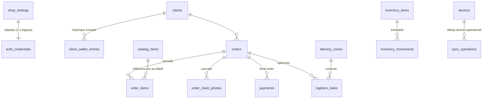

# 02 — Modèle de données PostgreSQL

Conventions : snake_case SQL ↔ camelCase DTO ; `BIGINT` = FCFA entiers ; `NUMERIC(12,2)` = quantités ; `TIMESTAMPTZ` = horodatages ; `DATE` = dates métier (Africa/Abidjan) ; UUIDv7 pour les clés primaires applicables.

## 1. Diagramme entités/relations

## 2. Tables (migration `backend/migrations/0001_init.sql`)

| Table | Colonnes clés | Contraintes / remarques |
|---|---|---|
| `shop_settings` | singleton `id=1` ; scalaires (shop_name, commune, phone, whatsapp_phone, rccm, ticket_footer_note, express percent via pressing_config, activity_scope) ; `blanchisserie_config/pressing_config/loyalty_config JSONB` ; `next_ticket_sequence BIGINT` (compat DTO, maintenu en sync) ; `onboarding_completed` | A19/A23 : **aucun secret ici** (voir `auth_credentials`) |
| `auth_credentials` | singleton `id=1` ; `password_hash` (PHC Argon2id), `algo` ('argon2id'\|'none') ; `legacy_hash`, `legacy_salt` (transition) ; `failed_attempts INT`, `locked_until TIMESTAMPTZ` | jamais exposé via `/settings` |
| `auth_sessions` | `id UUID`, `token_hash` (SHA-256 du token opaque, unique), `device_id`, `user_agent`, `expires_at`, `revoked_at` | révocable ; hash du token stocké, pas le token |
| `catalog_items` | `id UUID`, name, category, default_mode, `price_fcfa BIGINT>=0`, unit∈(pièce,kg,paire), active, image_url, turnaround_days, care_note, revision | |
| `clients` | id, full_name, phone, commune, address_note, `loyalty_points INT`, `prepaid_balance_fcfa BIGINT>=0`, subscription_label, subscription_expires_at DATE, `archived_at` | archivage au lieu de delete (A14) |
| `client_wallet_entries` | id, client_id FK cascade, entry_date, type∈(recharge,utilisation,bonus), amount_fcfa (négatif si utilisation), method, note | **historique complet sans plafond** (A18) |
| `orders` | id, `ticket_number UNIQUE`, ticket_seq, client_id FK, client_name/phone/commune (dénormalisés pour ticket), rack_slot, subtotal/express/delivery/discount/prepaid_used FCFA, loyalty_points_earned/redeemed, total/paid FCFA (`paid<=total`), status∈(recu,lavage,repassage,pret,livre), drop_off_date, due_date, delivered_at, notes, `voided_at`, `void_reason`, revision | void au lieu de delete (A14) |
| `order_items` | id, order_id FK cascade, catalog_item_id FK nullable, name, mode, `quantity NUMERIC(12,2)>0`, unit, unit_price_fcfa, line_total_fcfa, note, activity_type, pricing_basis, pieces_per_unit, weight_kg, is_express, express_fee_fcfa, express_due_date | snapshot du prix au dépôt |
| `order_claim_photos` | id, order_id FK cascade, caption, item_name, captured_at, mime, size_bytes, `storage_path` (privé) | A19 |
| `payments` | id, order_id FK nullable, ticket_number, client_name, amount_fcfa>0, method∈(especes,wave,orange_money,mtn_momo,moov_money), paid_at, type∈(acompte,solde,integral), `kind∈(order,prepaid_topup)`, `idempotency_key UNIQUE` | **jamais supprimés** (C1) ; recharges prépayées = kind=prepaid_topup (A17) |
| `expenses` | id, label, category, amount_fcfa>0, method, expense_date DATE, note, `deleted_at` | soft-delete (A14) |
| `delivery_zones` | id, commune, fee_fcfa, pickup_fee_fcfa, active, revision | |
| `logistics_tasks` | id, type∈(enlevement,livraison), status∈(planifie,en_cours,effectue,annule), client_id FK, coordonnées dénormalisées, order_id FK nullable, ticket_number, scheduled_date, time_slot, courier_name/phone, estimated_pieces, fee_fcfa, notes, revision | |
| `inventory_items` | id, name, sku, category, activity_scope, unit, `quantity NUMERIC(12,2)>=0`, min_threshold, unit_cost_fcfa, supplier, notes, `archived_at`, revision | A16 : quantity jamais négative |
| `inventory_movements` | id, item_id FK, item_name, type∈(entree,sortie,ajustement), quantity_delta, previous_qty, new_qty, unit, unit_cost_fcfa, total_cost_fcfa, reason, revision | **immuable, jamais supprimé** (C1) |
| `ticket_counters` | `year INT PK`, `last_seq BIGINT` | `SELECT … FOR UPDATE` dans la tx de création (A21) |
| `devices` | `device_id TEXT PK`, label, last_seen_at, `last_pull_revision BIGINT` | |
| `sync_operations` | id, device_id FK, `operation_id UUID`, op_type, payload JSONB, status∈(accepted,duplicate,conflict,rejected), result JSONB, error_code, received_at, applied_at, `UNIQUE(device_id, operation_id)` | idempotence sync (09) |
| `idempotency_keys` | `(scope, key) PK`, request_hash, response JSONB, created_at | idempotence HTTP (06) |
| `audit_logs` | id BIGSERIAL, actor, action, entity, entity_id, details JSONB, created_at | actions financières, void/restore, auth |

Index : `orders(created_at DESC)`, `orders(status)`, `orders(client_id)`, `orders(voided_at)`, `payments(paid_at)`, `payments(order_id)`, `payments(kind, paid_at)`, `expenses(expense_date, deleted_at)`, `logistics_tasks(scheduled_date,status)`, `inventory_movements(item_id, created_at)`, `client_wallet_entries(client_id, entry_date)`, revisions `DESC` sur tables mutables.

## 3. Révisions globales (sync pull)

`CREATE SEQUENCE change_seq;` — toute INSERT/UPDATE sur une table mutable affecte `revision = nextval('change_seq')` (écrit explicitement par les repositories dans la même transaction). Le curseur de pull = plus haute révision livrée.

## 4. Mapping TS → SQL → DTO

| TS (`types/pressing.ts`) | Table(s) | Notes DTO |
|---|---|---|
| `PressingSettings` | `shop_settings` (+ configs JSONB) | `pinHash/pinSalt` **retirés du DTO public** |
| `CatalogItem` | `catalog_items` | idem champs |
| `Client` | `clients` (+ `client_wallet_entries` pour walletHistory) | `walletHistory` = 40 dernières (compat UI) ; archive → filtré des listes |
| `ClientWalletEntry` | `client_wallet_entries` | dates RFC3339 |
| `PressingOrder`/`OrderLineItem` | `orders`/`order_items` | `claimPhotos` via `order_claim_photos` (dataUrl remplacé par URL privée `/api/v1/photos/{id}`) |
| `IntakePhoto` | `order_claim_photos` | `dataUrl` jamais retourné en liste ; fichier privé |
| `PaymentRecord` | `payments` | idem + `kind` |
| `ExpenseRecord` | `expenses` | `date` → `expense_date` |
| `DeliveryZone` | `delivery_zones` | |
| `LogisticsTask` | `logistics_tasks` | |
| `InventoryItem`/`InventoryMovement` | `inventory_items`/`inventory_movements` | quantités en nombre (2 déc. max) |
| `DatabaseBackup v3` | endpoint `POST /backup/restore` | importeur compat (phase 07) |

## 5. Règles transactionnelles

1. **Création commande** (une tx) : recalcul serveur (catalogue/offres/packs/express/livraison/fidélité) → verrou `ticket_counters(year)` → INSERT order+items → INSERT payment cash → MAJ client (prépayé, points, wallet entry) → MAJ `shop_settings.next_ticket_sequence` → audit.
2. **Paiement complémentaire** : relecture order, rejet si `amount > total-paid` (A15), INSERT payment, MAJ paid, idempotency key.
3. **Recharge prépayée** : MAJ solde + INSERT wallet entries + INSERT payment kind=prepaid_topup (si amount>0) — idempotente par clé.
4. **Statut logistique → `effectue` sur livraison liée** : MAJ task + MAJ order (`livre`, delivered_at) **dans la même tx** (corrige E2).
5. **Mouvement de stock** : lecture/verrou item, validation (sortie ≤ quantité — A16), INSERT mouvement, MAU item ; si `recordExpense` → INSERT dépense dans la même tx.
6. **Restore backup** : staging + validation complète avant écriture ; si invalide → 422 sans aucune écriture (corrige C2).
