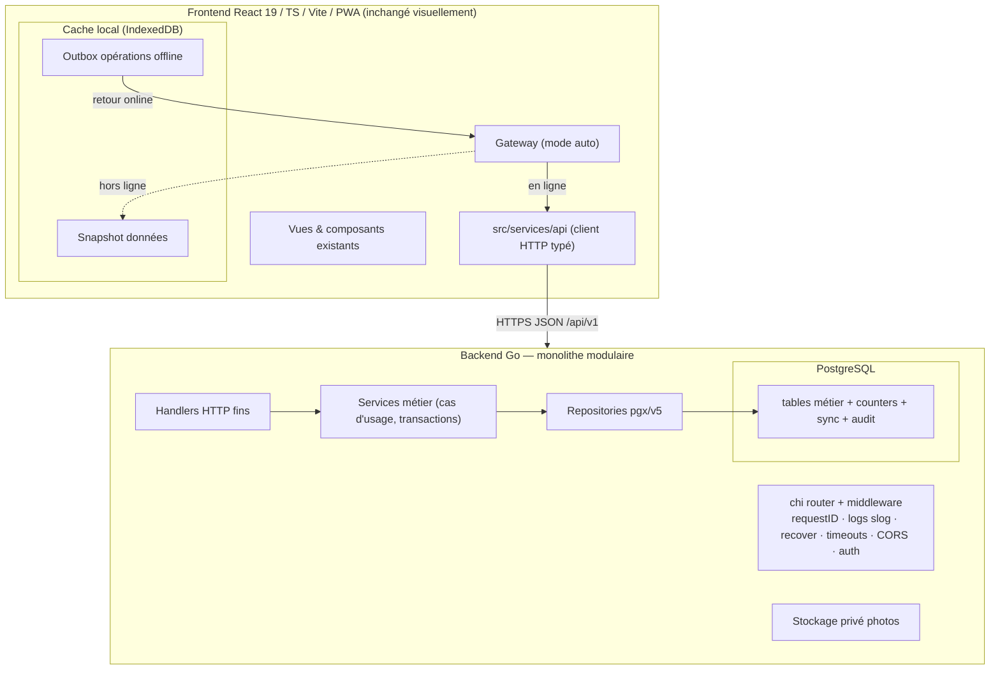

# 02 — Architecture cible

> Phase 02/10 — complète l'audit `01-current-state-audit.md`. Aucune règle métier n'est encore migrée à cette phase : ce document fige les contrats.

## 1. Vue d'ensemble



## 2. Décisions d'architecture (ADR)

| # | Décision | Justification |
|---|---|---|
| A1 | **Monolithe modulaire Go** (`backend/`), pas de microservices | App métier mono-équipe ; déploiement simple ; frontières par packages internes |
| A2 | **Router : `net/http` + `chi/v5`** | Standard léger, middlewares éprouvés, compatible `http.Handler` |
| A3 | **Driver : `pgx/v5` (pool)** | Driver PostgreSQL de référence, requêtes paramétrées, `COPY` si besoin |
| A4 | **Migrations : runner Go interne versionné** (`schema_migrations`, fichiers SQL numérotés, transactionnels) | Reproductible sans binaire externe ; équivalent golang-migrate avec zéro dépendance lourde |
| A5 | **Auth : secret opérateur hashé Argon2id**, session opaque dans cookie `HttpOnly` `SameSite=Strict` `Secure`(prod) | Pas de JWT longue durée ni `localStorage` ; sessions révocables en base |
| A6 | **Compatibilité PIN legacy** : `SHA-256("salt:pin:eclat-pressing-pin-v1")` vérifié uniquement à la première connexion, puis **re-hash immédiat Argon2id** | Transition sans perte d'accès ; le fallback non cryptographique du navigateur n'est jamais porté côté serveur |
| A7 | **Montants : `int64` FCFA / `BIGINT` SQL**, jamais de flottant | Conforme audit (risque C4) ; JSON en nombres entiers |
| A8 | **Quantités : `NUMERIC(12,2)`** | Poids au kilo décimal (6,5 kg) ; pièces en entiers via DTO |
| A9 | **IDs : UUIDv7** générés par le **serveur ou par le terminal** (offline) | Non prévisibles, triables, compatibles outbox |
| A10 | **Dates métier** (`dropOffDate`, `dueDate`, date dépense) : `DATE` calendaire en fuseau **Africa/Abidjan (UTC+0)** ; horodatages : `TIMESTAMPTZ` transportés RFC3339 | Abidjan est sans DST ; rend les rapports journaliers détermines |
| A11 | **Erreur API uniforme** `{ "error": { "code", "message", "details" } }` avec codes `invalid_request/unauthorized/forbidden/not_found/conflict/business_rule/rate_limited/internal` | Exploitable par le frontend, loggable |
| A12 | **DTO JSON camelCase**, enums strictement identiques aux unions TS (`recu…livre`, `especes…moov_money`, `planifie…annule`, `entree|sortie|ajustement`) | Compatibilité frontend garantie |
| A13 | **Le serveur recalcule et décide des montants** (prix catalogue, offers au poids, packs, express, livraison, fidélité, prépayé) ; le frontend ne fait qu'une prévisualisation | Corrige C4 ; le payload client ne peut pas imposer un total |
| A14 | **Annulation plutôt que suppression** pour les commandes (`voided_at/void_reason`), clients et articles de stock archivés, dépenses soft-deleted ; **aucun paiement jamais supprimé** | Corrige C1 (perte d'historique financier) |
| A15 | **Surpaiement rejetée** (`business_rule`) au lieu d'être tronquée silencieusement | Corrige C3 ; décision documentée, comportement différencié et testé |
| A16 | **Sortie de stock supérieure au disponible : rejetée** par défaut | Décision produit (audit §11.6) ; règle testée, modifiable via setting `inventoryAllowNegative` plus tard |
| A17 | **Comptabilité prépayée** : les recharges restent visibles en caisse via `payments.kind='prepaid_topup'` ; les rapports Z/mensuels exposent la répartition `order` vs `prepaid_topup` (comportement actuel préservé par défaut, mais lisible et auditable) | Corrige l'ambiguïté E1 sans changer le résultat affiché |
| A18 | **Wallet client complet en base** (`client_wallet_entries`, sans plafond) ; le DTO frontend retourne les 40 dernières entrées pour compat UI | Corrige E4 |
| A19 | **Photos de réserves** : fichiers dans un stockage privé (volume), métadonnées en base (`order_claim_photos`) ; import legacy des dataURL v3 avec validation MIME/taille | Corrige E6 ; secrets de chemin jamais déduits de l'entrée utilisateur |
| A20 | **CORS fermé par défaut** ; origines autorisées uniquement via `ECLAT_CORS_ORIGINS` (dev) ; cookie `SameSite=Strict` → pas de CSRF cross-site ; body limit 10 Mo ; timeouts serveur | Posture par défaut sûre |
| A21 | **Séquence de tickets** : table `ticket_counters(year, last_seq)` verrouillée `FOR UPDATE` dans la transaction de création ; `settings.nextTicketSequence` maintenu en synchronisation pour compat DTO | Corrige E5 ; deux dépôts simultanés → tickets uniques |
| A22 | **Revisions globales** (`change_seq`) sur les tables mutables pour le pull offline incrémental | Sync par curseur sans horloge distribuée |
| A23 | **Secrets** : uniquement via env serveur validée au démarrage ; jamais dans le bundle frontend ni les logs | Risque 3 de l'audit |

## 3. Couches et dépendances

```text
handler/http (chi) → service (cas d'usage) → repository (pgx) → PostgreSQL
        ↑                    ↑
     DTO/camelCase       domaine (types métier purs, erreurs typées)
```

- Le **domaine** ne connaît ni HTTP ni SQL. Erreurs métier typées (`ErrOverpayment`, `ErrInsufficientStock`, `ErrTicketConflict`, …).
- Les **services** orchestrent les transactions (une écriture sensible = une transaction).
- Les **repositories** portent tout le SQL.
- Les **handlers** : parsing, auth, validation transport, appel service, réponse JSON, mapping d'erreurs.

## 4. Domaines

`auth`, `settings`, `catalog`, `clients`(wallet inclus), `orders`(items+photos), `payments`, `cashbook`(expenses+reports), `logistics`(zones+tâches), `inventory`, `backup`, `sync`, `audit`.

## 5. Sécurité (postures par mode de déploiement)

| Contexte | Auth secret | Transport | Notes |
|---|---|---|---|
| Mono-poste local | PIN 5 chiffres acceptable | HTTP local | verrou d'interface ; API liée à localhost |
| Réseau local (LAN) | PIN autorisé, Argon2id + lockout | HTTPS recommandé (self-signed ou reverse proxy) | CORS fermé |
| Exposé Internet | **Secret fort obligatoire** (≥ 8 caractères non numérique), PIN 5 chiffres refusé à la création | HTTPS obligatoire, cookie `Secure` | rate-limit + lockout persistant + audit |

Le setup initial n'est possible que si **aucun credential n'existe** (état `virgin`), la route est fermée ensuite. Changement de secret exige la session courante + ancien secret.

## 6. Mode hors ligne (contrat résumé — détaillé en 09)

- Frontend : snapshot IndexedDB + **outbox** (`operationId` UUIDv7, `deviceId` stable, type, payload, dépendances, statut, tentatives).
- Push `/api/v1/sync/push` : application via **les mêmes services** que l'API en ligne ; déduplication `device_id+operation_id` ; ticket officiel attribué côté serveur (référence provisoire côté terminal).
- Pull `/api/v1/sync/pull?sinceRevision=N` : changements incrémentaux par révisions globales.
- Conflits : jamais de « last write wins » sur les montants/paiements/stocks — retour `conflict` avec état serveur, résolution utilisateur.
